<div align="center">



</div>

---

```console
santan@lab:~$ cat about.txt
```

I'm **Collins**, an embedded systems, full-stack and cybersecurity tinkerer, and a full-stack developer. I write firmware for ESP32-S3 boards and the tools around them. I build devices to survive being poked at, then I poke at them myself, only on hardware and networks I own.


## Stack

```console
santan@lab:~$ tree ~/stack
~/stack
├─ languages
│    C   C++   Python   PHP  JavaScript  Typescript  C#    
├─ backend
│    .NET   Node.js   Express   Django   Laravel
├─ frontend
│    React   Angular
├─ data
│    PostgreSQL   MySQL   MongoDB   Supabase
└─ infra
     Linux   Apache   Docker   AWS   Git  LVGL  Arduino
```

## Interests

| Area | What I do |
| :-- | :-- |
| **Embedded systems** | ESP32-S3 firmware with PlatformIO, LVGL touch UIs, BLE, Wi-Fi, MQTT and over-the-air updates |
| **Cybersecurity** | TLS-only MQTT, SHA-256 checked OTA with rollback, secrets kept out of git, Wi-Fi and LAN analysis on my own network |
| **Web Development** | Full-stack apps and APIs with React, Angular, Node.js, Django, Laravel and .NET, backed by PostgreSQL, MySQL, MongoDB or Supabase, shipped with Docker and AWS |

I also build full-stack apps: web apps and APIs with React, Angular, Node.js, Django, Laravel and .NET, backed by PostgreSQL, MySQL, MongoDB or Supabase, and shipped with Docker and AWS.
## Projects

| Project | What it is |
| :-- | :-- |
| [**IoT Commander**](https://github.com/collinskimcie/IoT-Commander-Dashboard) | Touchscreen terminal for a fleet of IoT devices, with a .NET backend and React dashboard |
| [**PocketNOC**](https://github.com/collinskimcie/POCKETNOC) | A pocket-sized network operations center: Wi-Fi analyser, LAN tools, uptime checks and alerts |
| **PULSEON** | Smartwatch firmware with BLE sync, watch faces, themes and OTA with rollback |
| Among others |

## Contact

| Channel | Handle |
| :-- | :-- |
| Email | [collinskimutai55109@gmail.com](mailto:collinskimutai55109@gmail.com) |
| GitHub | [collinskimcie](https://github.com/collinskimcie) |
| Instagram | [ckimcie](https://instagram.com/ckimcie) |
| Whatsapp| [ckimcie](https://wa.me/ckimcie) |
